# Relatório — Método de Newton para o SNL de Broyden

<!--
Legenda dos marcadores:
  [PREENCHER]  -> dado/texto que você ainda vai coletar
  [IMAGEM]     -> imagem a inserir (já aponto o caminho esperado em graficos/)
  [OK]         -> já preenchido com o que foi medido/analisado até agora; confira antes de entregar
Apague esta legenda e os marcadores na versão final.
-->

**Autores:** [PREENCHER]  **Data:** [PREENCHER]
**Máquina / CPU:** [PREENCHER: modelo, cache L2/L3, frequência fixa via likwid-setFrequencies]
**Compilador / flags:** `gcc -O3 -mavx2 -march=native` (Makefile) [OK]
**Parâmetros dos testes:** x0 = -1, ε = 0, MAXIT = 25, N ∈ {32, 64, 128, 256, 512, 1000, 2000, 4000} [OK — confira com `gendata.sh`]

---

## 1. Introdução

[PREENCHER: o problema (SNL de Broyden, F(X) = 0), método de Newton, e o objetivo do trabalho: comparar uma versão baseline com uma versão otimizada que explora a estrutura do sistema.]

Estrutura do sistema [OK]:

- `F_0 = -2x_0² + 3x_0 - 2x_1 + 1`
- `F_i = -2x_i² + 3x_i - x_{i-1} - 2x_{i+1} + 1`, para `1 ≤ i ≤ n-2`
- `F_{n-1} = -2x_{n-1}² + 3x_{n-1} - x_{n-2}`

A Jacobiana é tridiagonal: `J[i][i-1] = -1`, `J[i][i] = -4x_i + 3`, `J[i][i+1] = -2`. Só a diagonal principal depende de X.

## 2. Versão baseline (`base/`)

[OK] Jacobiana densa `double **J` (N×N); Gauss genérico com pivoteamento parcial (`pivot`, `triang`, `retrossubs`), custo O(N³) por iteração.

[PREENCHER: observações sobre o baseline, se houver.]

## 3. Versão otimizada (`otimizado/`)

### 3.1 Armazenamento: só a diagonal principal [OK]

As diagonais inferior (-1) e superior (-2) são constantes, então basta guardar `Jdiag[i] = -4x_i + 3`. Memória: O(N²) → O(N).

### 3.2 Triangularização sem pivô, O(N) [OK]

Só há o `-1` abaixo de cada pivô, então basta zerá-lo (implícito) e atualizar o elemento seguinte da linha:

```c
double m = -1 / Jdiag[i];      // m = A[i+1][i] / A[i][i]
Jdiag[i+1] -= -2 * m;          // ao lado do pivô sempre há -2
f[i+1]     -= f[i] * m;        // A[i+1][i+2] -= 0 (é zero)
```

Triangularizar é necessário, senão cada equação depende de uma variável ainda desconhecida (x_i e x_{i+1}).

### 3.3 Retrossubstituição específica [OK]

Como `A_ii X_i = F_i - A_{i,i+1} X_{i+1}` e `A_{i,i+1} = -2`:

```c
S[n-1] = f[n-1] / Jdiag[n-1];
S[i]   = (f[i] + 2*S[i+1]) / Jdiag[i];   // i = n-2 .. 0
```

### 3.4 Outras otimizações

- `restrict` em `calcF` e `calcJ` [OK]
- Impressão em buffer [PREENCHER: implementar e descrever, ou remover esta linha]
- Aviso de pivô pequeno em `triang` [PREENCHER: implementar e descrever limiar usado]
- [PREENCHER: outras]

### 3.5 Por que descartar o pivoteamento

**O que o pivoteamento protege:** pivô zero ou muito pequeno, que gera multiplicadores grandes e amplifica o erro.

**Por que não acontece aqui:** nas iterações medidas, x permanece negativo, então `-4x + 3 > 3`. Após a eliminação o pivô efetivo é `D[i+1] = (-4x_{i+1}+3) - 2/D[i]`, que reduz o pivô em no máximo 2/3. Medido [OK, reconfirme com seus logs]:

| x0 | N | menor \|pivô\| | \|m\| máximo | convergiu? |
|---|---|---|---|---|
| -1 | 32 a 1000 | 3,146 | ≈ 0,32 | sim |
| 0 | 32 a 1000 | 2,0 | 0,5 | sim |
| [PREENCHER] | [PREENCHER] | [PREENCHER] | [PREENCHER] | [PREENCHER] |

**Por que o pivô não pode ser zero:** a diagonal original `-4x + 3` só zera em x = 0,75, e o x medido fica negativo.

**O que o descarte compra:** matriz em O(N) em vez de O(N²) e eliminação em O(N) em vez de O(N³). Números: [PREENCHER: tempos de `eliminacaoGauss` base × otimizado, ver seção 5].

**Limitações (honestidade):**
- O argumento vale para os x0 e N testados. Em testes preliminares com x0 ≥ 0,5 os pivôs caíram para 1e-2…1e-4 e o método divergiu [OK; PREENCHER: tabela final dos x0 testados].
- A verificação de pivô pequeno em `triang` é a salvaguarda caso alguma entrada fuja desse regime [PREENCHER: após implementar].

## 4. Metodologia dos experimentos

- Ferramentas: LIKWID (`likwid-perfctr`, marker API), grupos MEM, L2CACHE, FLOPS_DP, FLOPS_AVX [OK]
- Trechos medidos: `newton` (total), `calcJ`, `eliminacaoGauss` [OK]
- Tempo: `timestamp()` em ms, média entre execuções [PREENCHER: nº de repetições]
- Frequência fixa em modo `performance`, core [PREENCHER]
- Como reproduzir: `./gendata.sh` em cada pasta, depois `python3 genplot.py` em `otimizado/` [OK]

## 5. Resultados

### 5.1 Tempo de execução

Tabela [PREENCHER: copiar de `resultados/Tempos.csv` de base e otimizado; unidade ms]

| N | newton base | newton otim | calcJ base | calcJ otim | Gauss base | Gauss otim | speedup Gauss |
|---|---|---|---|---|---|---|---|
| 32 | [PREENCHER] | 4,70 | [PREENCHER] | 2,28 | [PREENCHER] | 2,25 | [PREENCHER] |
| 64 | [PREENCHER] | 4,87 | [PREENCHER] | 2,31 | [PREENCHER] | 2,26 | [PREENCHER] |
| 128 | [PREENCHER] | 5,24 | [PREENCHER] | 2,41 | [PREENCHER] | 2,27 | [PREENCHER] |
| 256 | [PREENCHER] | 6,03 | [PREENCHER] | 2,56 | [PREENCHER] | 2,29 | [PREENCHER] |
| 512 | [PREENCHER] | 7,45 | [PREENCHER] | 2,63 | [PREENCHER] | 2,51 | [PREENCHER] |
| 1000 | [PREENCHER] | 9,92 | [PREENCHER] | 2,68 | [PREENCHER] | 2,73 | [PREENCHER] |
| 2000 | [PREENCHER] | 14,07 | [PREENCHER] | 2,48 | [PREENCHER] | 3,06 | [PREENCHER] |
| 4000 | [PREENCHER] | 22,99 | [PREENCHER] | 2,53 | [PREENCHER] | 3,69 | [PREENCHER] |

(valores "otim" = média dos 4 grupos no `Tempos.csv` atual; refaça após novas coletas)

[IMAGEM] `graficos/tempo_newton.png`, `graficos/tempo_calcJ.png`, `graficos/tempo_eliminacaoGauss.png`

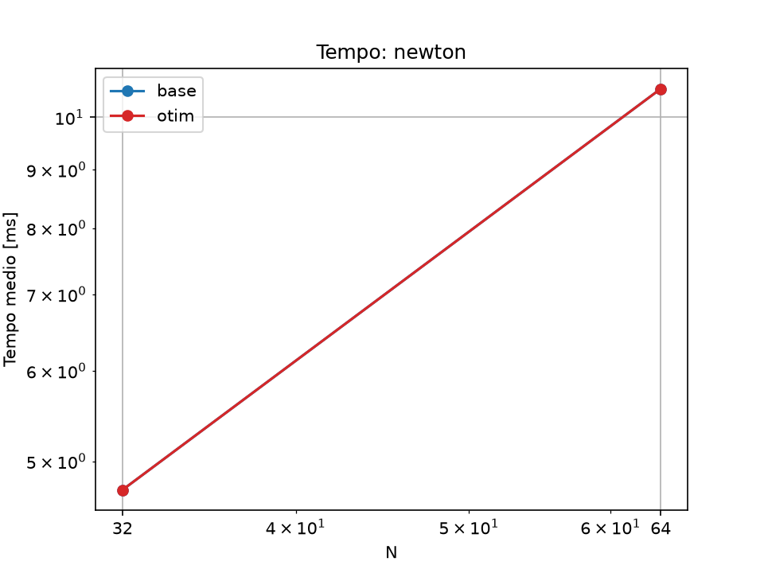
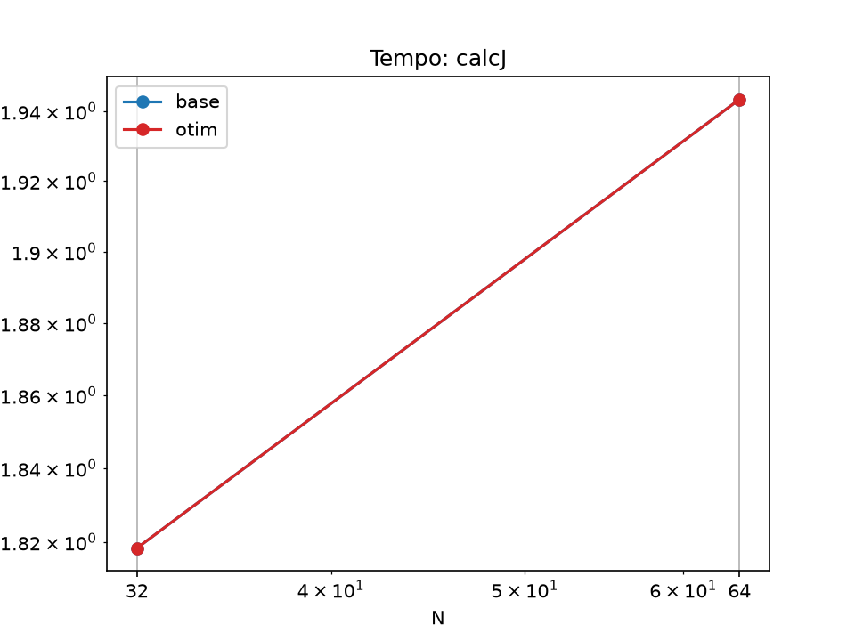
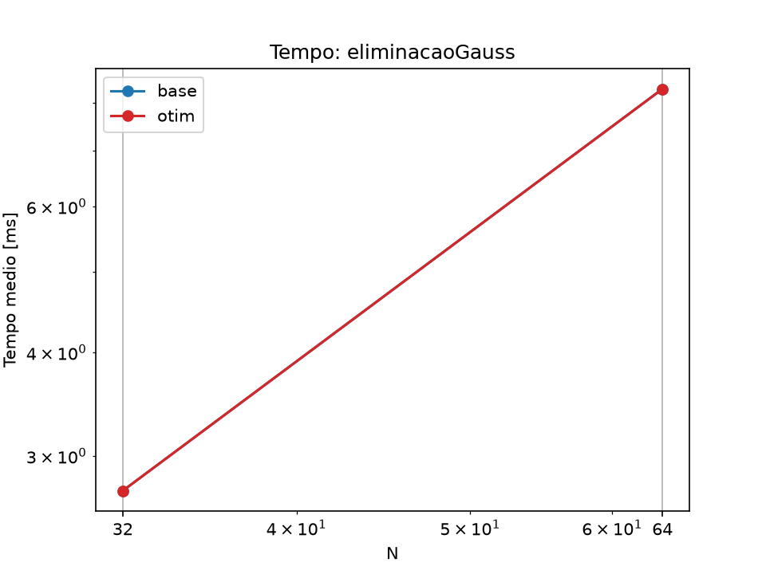

Análise: [PREENCHER. Pontos a comentar: crescimento ~linear do Gauss otimizado; ~2 ms de piso em N pequeno (overhead de timestamp/marcador, não trabalho útil); o `newton` total cresce mais por causa de `calcF`, atualização de X e `printf`.]

### 5.2 Banda de memória (MEM)

[IMAGEM]  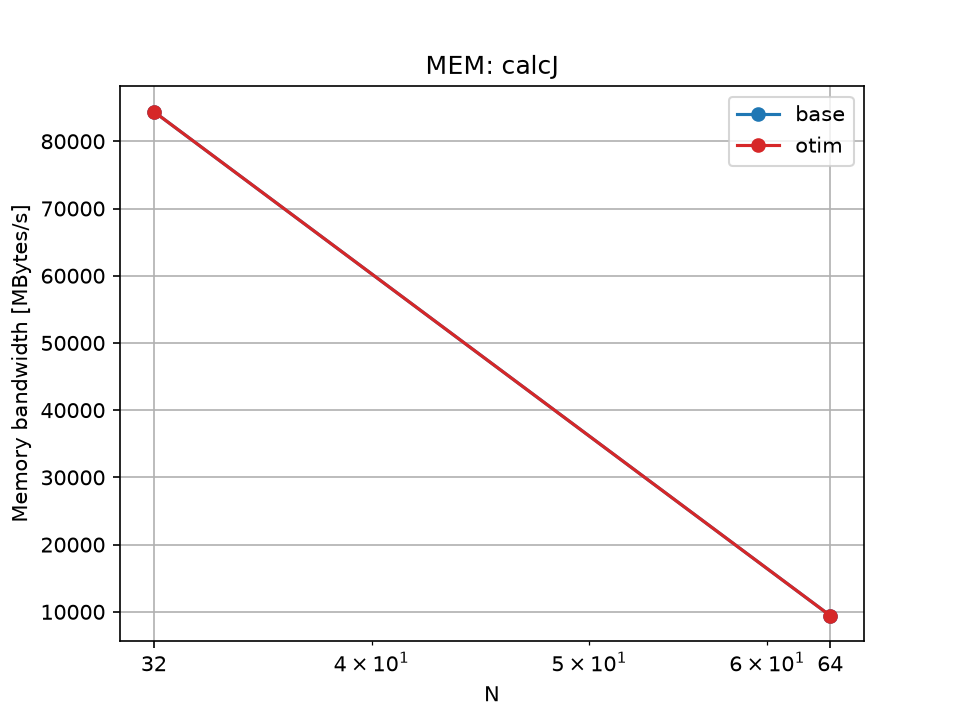 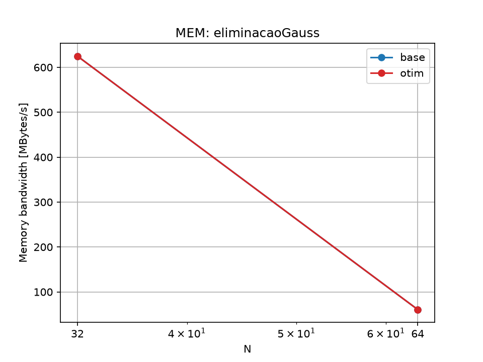

Análise: [PREENCHER]

### 5.3 Cache L2 (L2CACHE)

[IMAGEM] 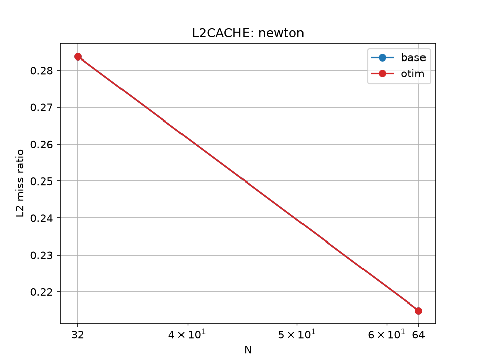 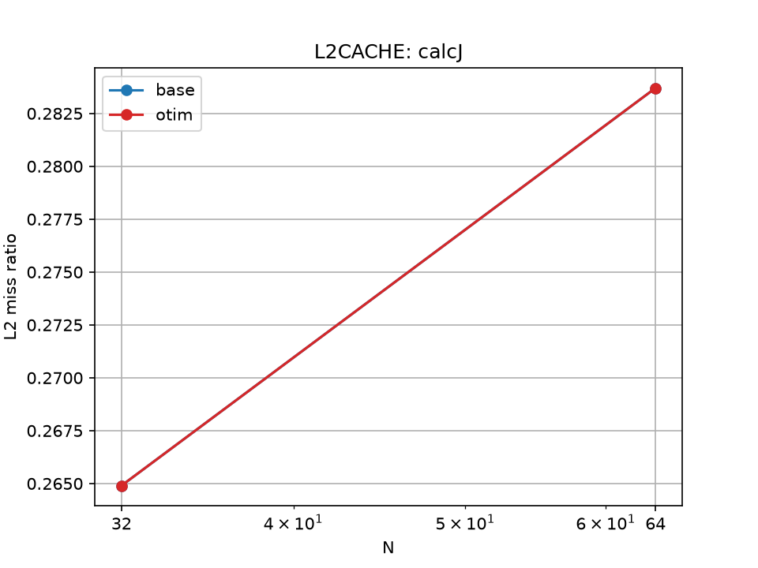 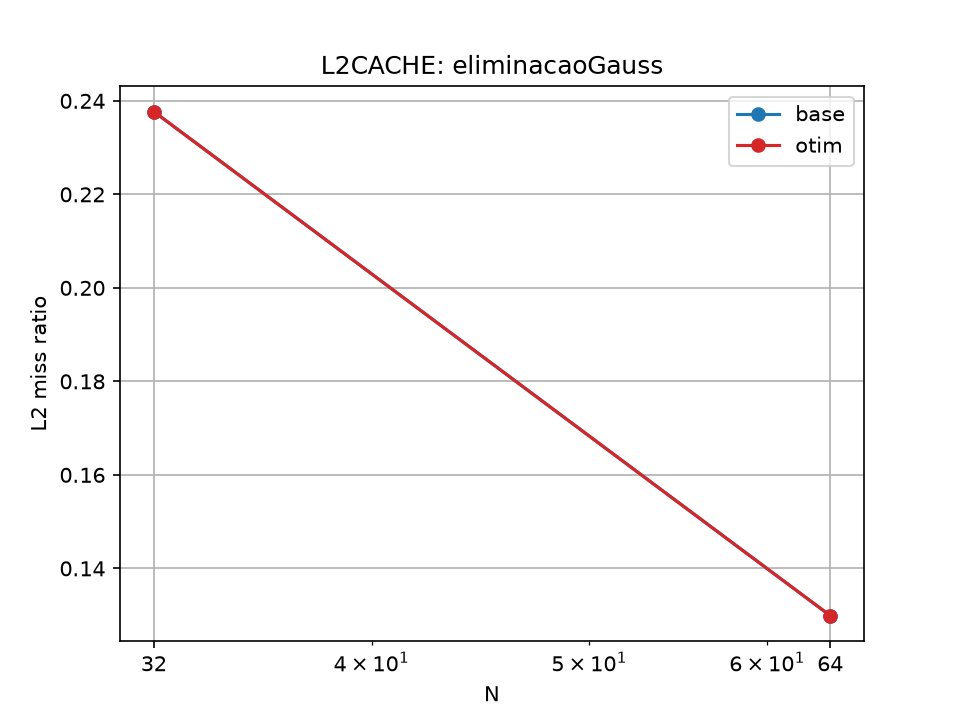

Análise: [PREENCHER. Relacione com o tamanho de N, a matriz densa do baseline (8N² bytes) e a diagonal do otimizado (8N bytes) × tamanho da L2.]

### 5.4 Operações de ponto flutuante (FLOPS_DP / FLOPS_AVX)

[IMAGEM] 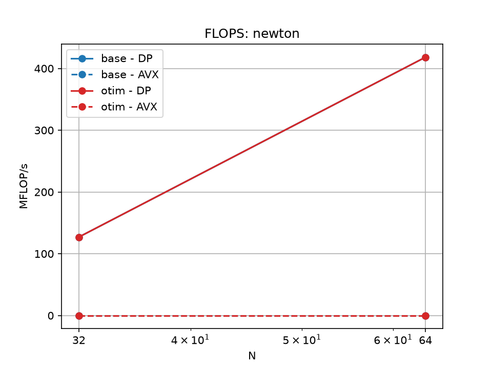 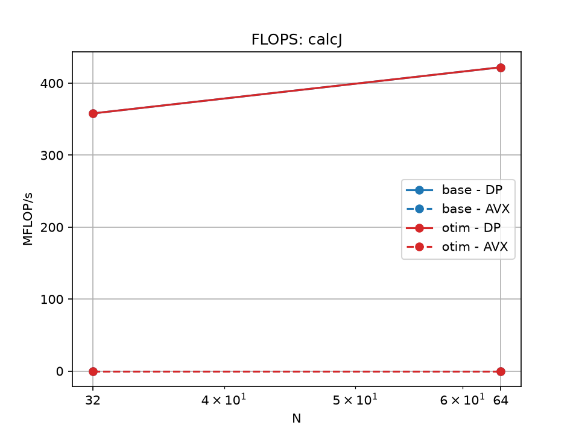 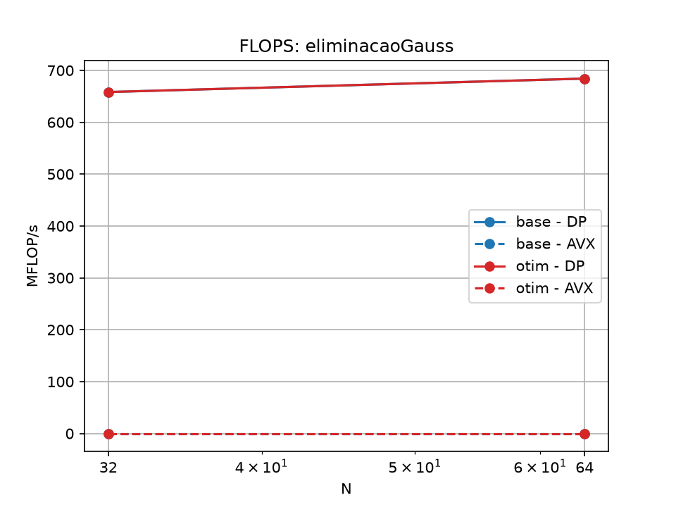

Análise: [PREENCHER. Comentar vetorização (`-fopt-info-vec` do Makefile): `calcJ` tende a vetorizar, `triang`/`retrossubs` têm dependência entre iterações e não.]

### 5.5 Convergência e estabilidade numérica

- Comportamento por x0: [PREENCHER: tabela x0 × (convergiu?, nº de iterações, menor pivô)]
- Evidência do aviso de pivô: [PREENCHER: saída do programa para uma entrada problemática]
- Comparação de resultados base × otimizado (mesmas soluções?): [PREENCHER: diferença máxima entre os X finais]

### 5.6 Outras análises

[PREENCHER]

## 6. Conclusão

[PREENCHER: ganho obtido e de onde veio (memória O(N), Gauss O(N), menos acessos à cache); limitações (x0 ≥ 0,5, pivoteamento removido); trabalhos futuros.]

## 7. Defesa — respostas prontas

- *E se o pivô fosse zero?* Na diagonal original ele só zera em x = 0,75; nos testes x permanece negativo e o menor pivô medido é ≥ 3,1. Além disso o programa avisa se o pivô ficar pequeno. [confirmar após implementar o aviso]
- *Por que não usar pivoteamento?* Trocar linhas cria uma segunda superdiagonal, e a matriz deixa de caber em uma só diagonal; o custo perderia o ganho de O(N). O risco é coberto pelo argumento da seção 3.5.

## Referências

[PREENCHER: enunciado do trabalho, documentação do LIKWID, etc.]
